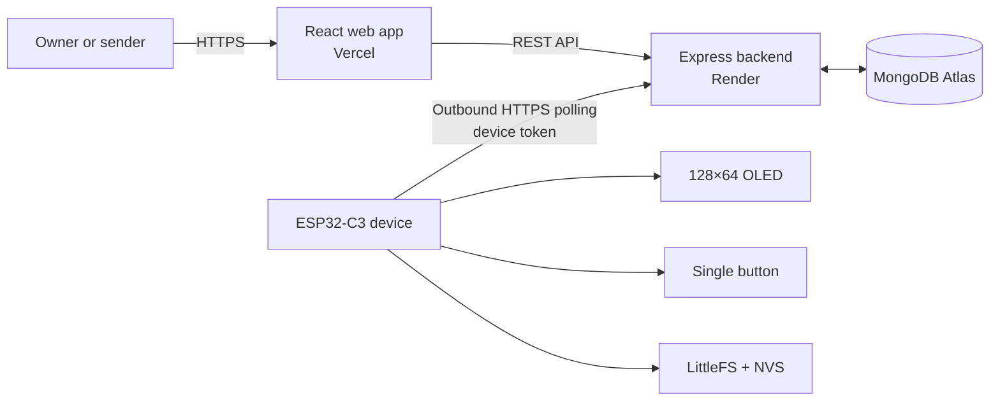
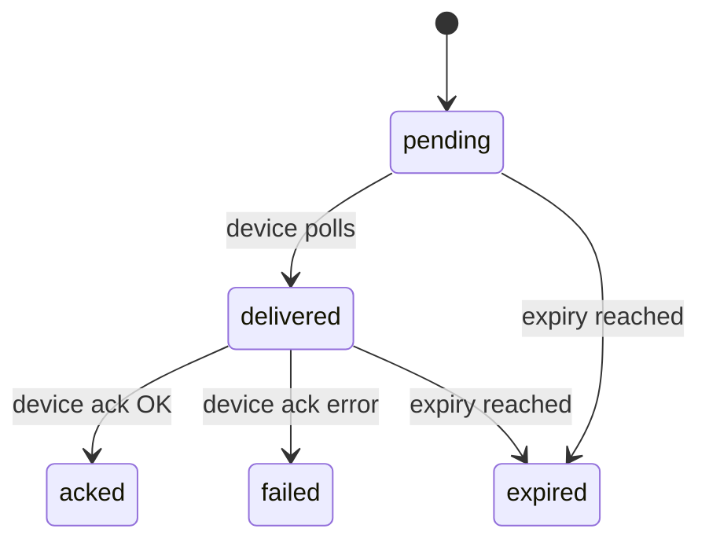

# PocketPet — Design Document

> **Status:** Design proposal  
> **Product status:** Design phase  
> **Source of truth:** `README.md` defines the agreed product scope, architecture and low-level constraints. This document turns those requirements into product, interaction, interface and visual-design guidance. Items marked **Proposed** are design recommendations, not already implemented behaviour.

---

## 1. Product vision

PocketPet is a small, personal digital pet that also acts as a remote message display. Its value comes from the connection between a physical object and the people who can send it something meaningful.

The device should feel like a tiny companion first and a connected gadget second:

- The animated dog is the default experience, not a loading screen.
- Messages and drawings should feel personal, lightweight and delightful.
- The device should remain enjoyable when Wi-Fi or the cloud is unavailable.
- Sending content should be simple enough to do in a few seconds.
- The OLED, button, battery and network constraints should shape the experience rather than be hidden behind unrealistic promises.

### 1.1 Product goals

1. Create an expressive, always-available digital pet on a compact keychain.
2. Make sending a message or pixel drawing from anywhere feel immediate and understandable.
3. Support shared use by an owner and invited senders.
4. Keep core pet and locally stored playlist experiences available offline.
5. Make the web app usable on both desktop and mobile browsers.

### 1.2 Non-goals for the initial release

The following are not required for the MVP:

- Real-time pixel streaming or an always-open device connection.
- A native Android or iOS application.
- Animated GIF playback, pet growth systems or multiple downloadable skins.
- Scheduled messages, push notifications or OTA firmware updates.
- Deep-sleep behaviour before the power and delivery-latency trade-off is measured.

These may be considered later; they should not complicate the first working end-to-end experience.

---

## 2. Design principles

| Principle | What it means in the product |
|---|---|
| **Pet first** | The device boots into a useful pet experience even without an account or internet connection. |
| **Personal, not noisy** | Messages, reactions and sender identity should feel intentional. Avoid unnecessary alerts and clutter. |
| **Simple interactions** | One physical button and a small set of clear gestures; web tasks should have short, obvious flows. |
| **Honest connectivity** | Distinguish queued, delivered and displayed states. Never imply that a message reached the device when it has only been accepted by the server. |
| **Offline resilience** | Local animations and downloaded playlists remain usable when disconnected. |
| **Small-screen first on device** | Every OLED screen must be legible at 128×64 and work with a monochrome display. |
| **Consistent rendering** | The web preview and the physical display should use the same bitmap dimensions, packing rules and text constraints. |
| **Safe by default** | Pairing, sharing, device credentials and destructive actions require deliberate, validated flows. |

---

## 3. Experience architecture

PocketPet has three user-facing surfaces:

1. **Physical keychain:** pet animation, message display, playlist playback, button interactions and setup feedback.
2. **Web application:** account, device dashboard, content composition, pixel editor, playlists, sharing and history.
3. **Cloud service:** authentication, device ownership, durable command queue, delivery acknowledgement and reaction routing.

The website and device are not expected to be on the same Wi-Fi network. The ESP32-C3 provisions onto the user's home Wi-Fi and initiates outbound HTTPS requests to the backend. The website independently connects to the same backend over HTTPS.

### 3.1 System context

### 3.2 Responsibility boundaries

- **Frontend:** helps people create and manage content; it does not talk directly to the ESP32.
- **Backend:** authenticates users and devices, authorizes actions, stores content and commands, and tracks delivery.
- **Firmware:** validates and renders commands, manages local state and storage, and reports acknowledgements/events.
- **MongoDB:** durable source for user, device, command, content, playlist, invite and event records.

The cloud stores content and commands; the device renders them. A full 128×64 monochrome bitmap is 1,024 bytes.

---

## 4. Information architecture

### 4.1 Main navigation

**Proposed web navigation**

- **Dashboard** — overview of devices, online status, last seen and quick send.
- **Device** — device status, quick composer, command history and reactions.
- **Create** — text or pixel drawing.
- **Playlists** — create, edit and manage ordered content.
- **Sharing** — invite and manage senders for a device.
- **Settings** — account and device settings.

Keep the primary navigation compact. On narrow screens, use a bottom navigation or a simple menu rather than squeezing a full desktop sidebar into the viewport.

### 4.2 Page purpose and primary action

| Page | Primary user question | Main action |
|---|---|---|
| Login / Register | “How do I access my PocketPet?” | Sign in / create account |
| Dashboard | “Is my device available?” | Open device or send something |
| Pair device | “How do I link this keychain to my account?” | Enter the six-digit code |
| Device detail | “What is happening on my device?” | Compose, view history or settings |
| Compose | “What do I want it to show?” | Send text or a drawing |
| Pixel editor | “Can I make a tiny picture?” | Draw, import and send/save |
| Playlists | “What should it play locally?” | Create or start a playlist |
| Members | “Who can send to this device?” | Invite or remove a sender |
| History | “Did my content reach the device?” | Inspect command status |
| Settings | “How is my device configured?” | Update supported settings |

---

## 5. Visual design direction

The README defines product capabilities and technical constraints, but does not prescribe a finished brand identity. The following is a **proposed visual direction** and can be refined after the first UI prototype.

### 5.1 Personality

- Warm, friendly and playful, without looking like a toy dashboard for children.
- Minimal surfaces with a little pixel-art character.
- Clear status and controls; decoration must never compete with the content being sent.
- Use small illustrations and pixel motifs as accents, not as background noise.

### 5.2 Suggested palette

Use a restrained neutral base with one friendly accent. Keep semantic status colours consistent.

| Token | Suggested value | Usage |
|---|---|---|
| `background` | `#F7F7F4` | Main page background |
| `surface` | `#FFFFFF` | Cards, panels and dialogs |
| `surface-muted` | `#EFEFEA` | Secondary sections and input backgrounds |
| `text-primary` | `#20231F` | Main text |
| `text-secondary` | `#6D716A` | Supporting text |
| `border` | `#E2E4DC` | Dividers and outlines |
| `accent` | `#527A63` | Primary actions and selected states |
| `accent-soft` | `#E7F0E8` | Subtle accent backgrounds |
| `success` | `#2E7D55` | Confirmed success |
| `warning` | `#A86B19` | Delayed or expiring states |
| `danger` | `#B54747` | Destructive actions and errors |

These are starting tokens, not fixed implementation requirements. Maintain contrast and do not communicate status through colour alone.

### 5.3 Typography

**Proposed:**
- Use a highly legible sans-serif for interface text.
- Use a slightly expressive display face only for page titles or small brand moments.
- Keep body text around 14–16 px on desktop and mobile.
- Use tabular numerals for pairing codes, battery percentages, timestamps and counters.
- Avoid overly small labels, especially for status and device connectivity.

### 5.4 Shape, spacing and components

- Use a consistent spacing scale based on 4 px.
- Prefer medium corner radii for cards and inputs; reserve pill shapes for compact chips and status labels.
- Buttons should have clear hierarchy: primary, secondary, quiet and destructive.
- Inputs should always have visible labels; placeholders are examples, not labels.
- Use restrained shadows. Borders and spacing should provide most of the structure.
- Use skeletons for loading data and explicit empty states when a user has not paired a device or created content.

### 5.5 Iconography and pixel art

- Use a consistent outline icon family for web controls.
- Use the PocketPet pixel icon set for message content and pet-related moments.
- Keep interface icons and message icons conceptually separate.
- The canonical content icon list is `shared/icons.json`; frontend picker, backend validation and firmware renderer must agree on icon names and IDs.

---

## 6. Web application UX

### 6.1 Dashboard

The dashboard should answer three questions immediately:

1. Which PocketPet devices belong to me or are shared with me?
2. Are they online, and when were they last seen?
3. What can I do next?

**Device card content**
- Device name.
- Online/offline indicator derived from `lastSeenAt` and the configured polling interval.
- Last-seen time.
- Battery percentage when available.
- Quick action to compose/send.
- Link to device detail.

Do not label a device “offline” simply because one poll was missed. Use the backend's derived online rule and show “Last seen …” to make the status understandable.

**Empty state**
- Friendly explanation that no device is paired yet.
- Primary action: **Pair a device**.
- Short instruction to connect the device to Wi-Fi and enter the code shown on its OLED.

### 6.2 Pairing flow

1. User opens **Pair a device**.
2. User connects the ESP32 to home Wi-Fi using its `PocketPet-Setup` access point and captive portal.
3. Device registers with the backend and displays a six-digit pairing code.
4. User enters the code in the web app.
5. Backend validates the code, expiry and attempt limit, then assigns ownership.
6. Device's next poll reports that it is paired; the OLED confirms success and returns to pet mode.

**UX requirements**
- Six separate visual digit cells may be used, but the underlying input should support paste and keyboard entry.
- Auto-focus the next cell and allow backspace navigation.
- Explain expiry and retry behaviour without exposing internal implementation details.
- Show actionable errors: invalid code, expired code, too many attempts, or already claimed.
- Never ask the user to enter their home Wi-Fi password into the web app. Wi-Fi credentials are entered directly into the device's local provisioning portal and stay on the device.

### 6.3 Compose experience

The composer should make the OLED's constraints visible before sending.

**Content types**
- Text.
- Monochrome 128×64 bitmap.

**Text composer**
- Maximum 64 characters under the README's text rules.
- Count each valid `:icon:` token as one character.
- Allow up to four lines.
- Use printable ASCII plus supported icon tokens; do not promise arbitrary emoji support.
- Provide a live OLED preview using the same font metrics and icon rules as firmware.
- Provide a duration control and a clear send action.

**Send feedback**
Show the command lifecycle honestly:

`Queued → Delivered → Displayed`

- **Queued:** backend accepted and stored the command.
- **Delivered:** device polled and received it.
- **Displayed:** device acknowledged successful execution/display.
- **Failed / Expired:** explain that the content was not displayed and provide a retry action where appropriate.

Do not use “Delivered” and “Displayed” interchangeably.

### 6.4 Pixel editor

The editor must operate on a logical 128×64 monochrome grid.

**Layout**
- Main canvas with a visible pixel grid and zoom.
- Tool rail: pencil, eraser, line, rectangle, ellipse, fill, invert and clear.
- Undo/redo controls.
- Import image action.
- Preview of the final OLED result.
- Save and send actions kept distinct.

**Behaviour**
- Canvas supports mouse, pen and touch.
- Drawing uses a 1-bit buffer, not a scaled screenshot.
- Undo/redo stores up to 50 snapshots.
- Imported images are scaled to 128×64 and converted using thresholding or Floyd–Steinberg dithering.
- Export uses the canonical 1-bit bitmap packing format.
- Confirm before clearing the whole canvas or discarding unsaved edits.

**Important consistency rule:** frontend packing and firmware decoding must use the same row-major layout, 16 bytes per row, LSB as the leftmost pixel, and exactly 1,024 decoded bytes.

### 6.5 Playlist editor

A playlist is an ordered set of text or bitmap items, each with a duration.

**Editor structure**
- Playlist name and repeat setting.
- Ordered item list with drag handles.
- Item type, compact preview and duration.
- Add text / add drawing actions.
- Total runtime summary.
- Save playlist and start on device actions.

**Constraints from the README**
- Maximum 20 items.
- Text item maximum 64 characters.
- Bitmap item exactly 1,024 bytes after decoding.
- Duration range: 1–600 seconds per item.

Make the repeat behaviour explicit before starting playback. A non-repeating playlist plays once and returns to pet mode; a repeating playlist is the mode intended to resume after reboot.

### 6.6 Sharing and permissions

The device has one owner and may have invited senders.

- Owner can rename/configure, invite/remove senders and unpair.
- Owner and sender can view device status and send content or playlists.
- Senders use their own saved library and see only their own command history.
- A sender can leave the device.
- Reactions are routed to the person who created the referenced command.

The UI should show the current user's role and avoid presenting owner-only controls to senders. The backend remains authoritative; hiding a button is not authorization.

### 6.7 History and reactions

History should show:
- Content preview or title.
- Sender identity.
- Creation time.
- Command status.
- Expiry or failure reason when available.

Reaction entries should identify the reaction and the message it refers to. Unread reactions should be visually distinct, but should not interrupt the user's current task.

---

## 7. Device interface design

The OLED is 128×64 monochrome. Each screen must be designed for that exact resolution and tested on the real display.

### 7.1 Screen hierarchy

| Screen | Purpose | Key elements |
|---|---|---|
| Boot | Confirm the device started | Small PocketPet mark or dog frame |
| Provisioning | Help user connect to setup AP | `Join Wi-Fi`, SSID, portal address |
| Connecting | Explain temporary network activity | Connecting indicator, retry/offline message |
| Pairing | Link the device to an account | Six-digit code, expiry/retry guidance |
| Pet | Default standalone experience | Animated dog |
| Content | Show a message or drawing | Content, optional sender header |
| Playlist | Play local ordered content | Current item; minimal progress cue if space allows |
| Feedback | Confirm a local action | Paired, saved, reaction sent, error |

Avoid dense menus. The device has one external button, so it should not expose a deep navigation tree.

### 7.2 Pet mode

The dog is the default home screen and must work without network access.

Defined behaviours:
- `IDLE`
- `WALK_LEFT`
- `WALK_RIGHT`
- `SIT`
- `SLEEP`
- `HAPPY`
- `BARK`

The README proposes random behaviour changes every 4–12 seconds and animation frame periods around 120–200 ms. Use these as starting values and tune on hardware.

New content should temporarily take priority over the pet animation. When content duration ends or the user dismisses it, return to pet mode.

### 7.3 Content display

**Text**
- Choose the largest fitting font from the defined font set.
- Word-wrap to the 128 px display width.
- If content still does not fit, use a vertical marquee.
- Render supported icon tokens using the shared icon definitions.
- Unknown icon tokens should render as literal text only if they reach firmware; backend validation should reject unknown tokens.

**Bitmap**
- Draw the exact 128×64 1-bit frame.
- Validate payload length before rendering.
- Reject corrupt or unsupported data and acknowledge an error rather than displaying partial garbage.

**Sender label**
- When `showSender` is enabled, show `from <name>` for the first two seconds when the sender is not the owner.
- Keep the label short enough for the OLED; the README specifies truncating the name to ten characters.

### 7.4 Playlist playback

- Store playlist metadata and bitmap files in LittleFS.
- Playback is index-based.
- A short button press during playback skips to the next item.
- A long press stops playback.
- A non-repeating playlist returns to pet mode after its last item.
- A repeating playlist is intended to resume after reboot.

### 7.5 Button interaction model

The single external button is the primary physical control.

| Gesture | Action | Feedback |
|---|---|---|
| Short press | Cycle Pet → Playlist (if stored) → Pet; dismiss custom content | Immediate screen transition |
| Double press | Send heart reaction during the valid reaction window | Dog happy animation + heart |
| Triple press | Send smile reaction during the valid reaction window | Dog happy animation + smile |
| Hold 3 seconds | Open Wi-Fi provisioning | Provisioning screen |
| Hold 10 seconds | Start factory reset flow | Confirmation prompt before destructive reset |

**Interaction design notes**
- Debounce input and define multi-tap timing centrally.
- Make long-press detection take precedence over tap sequences.
- Give visible feedback when a gesture is recognized.
- Do not silently reset the device on an accidental long press; require the on-screen confirmation specified in the README.
- The README also says a short press during playlist playback skips to the next item. The exact interaction between this behaviour and the general mode-cycle rule should be finalized before firmware implementation.

### 7.6 Display power behaviour

The README proposes dimming after 20 seconds in pet mode and turning the OLED off after 60 seconds, with a button press waking it. This should be treated as display power management, not proof that the MCU or Wi-Fi is asleep.

The firmware must keep display state, connectivity state and application mode separate. A dark OLED must not accidentally stop command polling or cause a pending message to be lost.

---

## 8. Firmware interaction and state design

### 8.1 Separate connectivity from display mode

Connectivity and what the user sees are orthogonal concerns.

**Connectivity state**
- `BOOT`
- `PROVISIONING`
- `CONNECTING`
- `REGISTERING`
- `AWAITING_PAIR`
- `ONLINE`
- `OFFLINE_PET`

**Display mode**
- `PET`
- `CONTENT`
- `PLAYLIST`

This separation allows the dog to continue animating while the device reconnects, and allows the display to show content without changing the underlying network state.

### 8.2 Main firmware modules

| Module | Responsibility |
|---|---|
| `app_state` | Top-level state and transitions |
| `button_manager` | Debounce and gesture recognition |
| `display_manager` | OLED drawing, layout and screen composition |
| `pet_animation` | Dog behaviours and frame scheduling |
| `wifi_manager` | Station connection and reconnect backoff |
| `provisioning` | Setup AP, DNS and captive portal |
| `cloud_client` | Registration, polling and acknowledgements |
| `command_executor` | Validate and execute command types |
| `content_player` | Single content item and duration timer |
| `playlist_manager` | Playlist persistence and playback |
| `storage_manager` | NVS and LittleFS access |
| `icon_renderer` | Parse icon tokens and draw glyphs |
| `reaction_manager` | Reaction window and event delivery |
| `power_manager` | Battery read and display power behaviour |

### 8.3 Non-blocking execution

Use a cooperative, `millis()`-based scheduling approach. Avoid long `delay()` calls in the main loop.

The loop should give regular time to:
- Button sampling and gesture recognition.
- Wi-Fi connection management.
- Cloud poll scheduling and HTTP completion.
- Command execution.
- Pet animation frame scheduling.
- Content and playlist timers.
- Battery measurement and display dimming.

A slow network request must not freeze button handling or OLED animation.

---

## 9. Cloud command and delivery UX

### 9.1 Command lifecycle

The backend stores commands durably in MongoDB. The device polls for commands with a sequence greater than its last executed sequence.

### 9.2 Delivery guarantees

- MVP transport is HTTPS polling.
- Delivery is at-least-once, not exactly-once.
- Each device has a monotonically increasing command sequence.
- Firmware ignores commands whose sequence is less than or equal to `last_seq`.
- The device persists the highest executed sequence.
- Acknowledgements are idempotent.
- The next poll's `lastSeq` can implicitly confirm previously delivered commands if an acknowledgement was lost.
- Expired content must not be displayed.

### 9.3 Polling and latency

The README sets a default poll interval of 8 seconds, with server-adjustable values from 5 to 60 seconds. It also proposes stretching the interval after an idle period, with an open trade-off between latency and battery life.

The UI should not promise instant delivery. It should display a pending state while the device is yet to poll. Long-polling and WebSockets are later options, not MVP assumptions.

### 9.4 Cold starts and offline states

Render's free service may sleep when idle. The design should:
- Keep commands in MongoDB so a backend restart does not erase them.
- Handle request timeouts and retries with backoff.
- Avoid displaying an online state based only on a stale frontend cache.
- Explain that a device may take longer to receive a message after backend inactivity.
- Keep pet mode and locally stored playlists working while disconnected.

---

## 10. Data and rendering contracts

These formats are shared contracts across frontend, backend and firmware. Changes must be coordinated.

### 10.1 Bitmap contract

- Resolution: 128 × 64.
- Colour depth: 1 bit per pixel.
- Decoded size: 1,024 bytes.
- Row-major order.
- 16 bytes per row.
- LSB is the leftmost pixel.
- Pixel `(x, y)` is stored at byte `y * 16 + (x >> 3)`, bit `x & 7`.
- Transport encoding: standard Base64.

### 10.2 Text contract

- Maximum 64 characters, counting each valid icon token as one character.
- Printable ASCII characters.
- Up to four newline-separated lines.
- Icon token format: `:name:`.
- Supported names are defined by `shared/icons.json`.
- Emoji are not part of the initial text contract; use the built-in pixel icon set.

### 10.3 Initial icon vocabulary

`heart`, `star`, `bone`, `paw`, `smile`, `sad`, `kiss`, `sun`, `moon`, `coffee`, `music`, `gift`, `cake`, `check`, `bell`, `hug`.

Use 16×16 glyphs inline. A message containing only one icon may use the 32×32 centred version.

### 10.4 Time contract

- Server timestamps use ISO-8601 UTC.
- Device can use `serverTime` from poll responses.
- Content durations are relative; MVP does not require device NTP synchronisation.

---

## 11. Security and privacy UX

Security controls should be reflected in product behaviour, not only backend middleware.

- Wi-Fi credentials are entered through the device's local provisioning portal and must never be sent to the cloud.
- Pairing codes are short-lived, one-time-use and attempt-limited.
- Device tokens are opaque, revocable and sent only over TLS.
- Claimed devices cannot be claimed again by spoofing their hardware ID.
- Every device action is authorized against owner/sender membership.
- Invite codes are random, single-use and expire after 48 hours.
- User passwords are hashed; passwords and tokens must not appear in logs.
- Validate text, icon names, bitmap size and playlist limits on the server and device.
- Use TLS certificate validation; do not ship `setInsecure()` in production.
- Enable ESP32 flash/NVS encryption before treating physical device theft as a mitigated threat.

**User-facing copy:** explain what is happening and what the user can do. Do not expose raw stack traces, database errors, token hashes or internal identifiers.

---

## 12. Error, empty and recovery states

| Situation | Device behaviour | Web behaviour |
|---|---|---|
| No Wi-Fi credentials | Start provisioning AP | Explain local setup steps |
| Wi-Fi connection fails | Stay in pet mode; retry with backoff | Show offline / last seen |
| Backend unavailable | Continue pet and local playlist; retry later | Show queued or delayed status |
| Device not paired | Show pairing code | Allow code entry |
| Pairing code expired | Refresh/show a new code when supported | Explain expiry and allow retry |
| Command expired | Do not display stale content | Show expired status |
| Invalid bitmap | Reject command and report error | Show that the drawing could not be displayed |
| Playlist storage full | Reject playlist with `STORAGE_FULL` | Explain storage limitation |
| Device reboot/crash loop | Watchdog; safe pet mode after repeated reboots | Show last-seen state |
| Reaction cannot be sent | Keep local visual feedback; retry according to queue policy | Do not show a reaction until backend records it |

The device's reaction queue is specified as RAM-only, with a maximum of five events and a ten-minute age limit. It can be lost on power failure; this limitation should be understood and tested.

---

## 13. Accessibility and responsive behaviour

### Web
- All actions must be keyboard accessible.
- Inputs require persistent labels and clear validation messages.
- Focus indicators must be visible.
- Status must include text or an icon, not colour alone.
- Pixel editor tools need accessible names and keyboard alternatives where practical.
- Touch targets should be comfortably sized on mobile.
- Dialogs must trap focus and return focus to the triggering control.
- Respect reduced-motion preferences for web animations.

### Device
- Use high-contrast monochrome layouts.
- Avoid tiny text and overly dense screens.
- Use simple, distinguishable animation states.
- Pairing code must remain readable long enough to enter.
- Provide visual feedback for button gestures and errors.

### Responsive layout
- Desktop: navigation sidebar or compact top navigation; editor canvas and tools can sit side by side.
- Tablet: reduce secondary panels and keep the canvas central.
- Mobile: single-column flows, large touch controls, editor tools in a compact toolbar or drawer, and no horizontal scrolling for primary tasks.

---

## 14. Performance and power considerations

- Keep bitmap payloads at 1,024 bytes decoded.
- Limit playlists to 20 items.
- Keep the main firmware loop non-blocking.
- Use Wi-Fi modem sleep as proposed.
- Measure actual current draw on the assembled hardware before publishing a battery-life estimate.
- Polling more frequently improves message latency but consumes more power.
- OLED dim/off behaviour should be tested separately from Wi-Fi and MCU behaviour.
- Battery measurement should be calibrated against the actual divider, ADC characteristics and battery.
- Confirm that the selected LiPo charger board supports the intended load behaviour. A TP4056-class charger does not automatically provide a safe power-path/load-sharing design.

Do not claim a specific runtime until measured across realistic usage patterns.

---

## 15. Testing and design validation

### 15.1 UX validation

Test the main tasks with someone who has not seen the project:

1. Provision the device onto Wi-Fi.
2. Pair it to an account.
3. Send a short text message.
4. Understand whether the message is queued, delivered or displayed.
5. Create and send a pixel drawing.
6. Create a playlist and understand repeat behaviour.
7. Invite a sender and verify their permissions.
8. React to a message and find the reaction in the web app.
9. Recover from Wi-Fi loss.

Observe where people hesitate, misunderstand status or need instructions.

### 15.2 Technical validation

| Area | Validation |
|---|---|
| Firmware | Native tests for command parser, playlist serialization and retry/backoff |
| Backend | Unit tests for sequence allocation, pairing, expiry and authorization |
| Backend integration | Supertest + in-memory MongoDB for pairing and poll/ack lifecycle |
| Device simulation | Fake device registers, polls, executes and acknowledges without physical hardware |
| Frontend | Vitest + React Testing Library |
| Bitmap logic | Pack/unpack, drawing tools, dithering and edge cases |
| End-to-end | Playwright: register → pair → send → displayed |
| Hardware | iOS/Android provisioning, router change, Wi-Fi loss, cold start and 24-hour soak test |

### 15.3 Visual validation

- Compare the browser OLED preview against a photograph or captured output from the actual display.
- Test every font size and wrapping boundary.
- Test all 16 icon glyphs inline and centred.
- Test bitmap patterns at the left/right edges and top/bottom rows to catch bit-order mistakes.
- Test OLED legibility at normal keychain viewing distance.

---

## 16. Delivery scope

### MVP sequence

| Phase | Deliverable | Design acceptance |
|---|---|---|
| 0 | Repository, CI and environment | All packages build |
| 1 | OLED, dog animation and button modes | Pet experience works offline |
| 2 | Wi-Fi provisioning | Phone can provision and credentials survive reboot |
| 3 | Backend auth, registration, pairing, poll/ack and simulator | Device lifecycle works without physical hardware |
| 4 | Frontend auth, dashboard and pairing | User can claim a device |
| 5 | Text messages | Message appears and UI reaches displayed state |
| 6 | Pixel editor and bitmap send | Preview matches physical OLED |
| 7 | Playlists | Playlist plays locally and follows repeat setting |
| 8 | Icons, sharing and reactions | Sender permissions and reaction routing work |
| 9 | Hardening | TLS, reconnect, power, enclosure and soak test |

### Later possibilities

- Long-polling or WebSocket delivery.
- Scheduled messages.
- Pet growth/personality.
- PWA push notifications.
- GIF-like animation sequences.
- OTA firmware updates.
- Multiple pet skins.

These are future extensions, not MVP dependencies.

---

## 17. Decisions to resolve before implementation is considered complete

The README explicitly leaves several decisions open. Keep them visible rather than silently choosing defaults.

| Topic | Current position | Decision still needed |
|---|---|---|
| Polling vs battery life | Default 8 s; configurable 5–60 s | Choose an idle interval policy after measuring current draw and acceptable delivery latency |
| Poll maximum | Config says 60 s; power narrative says up to 30 s | Reconcile the two limits |
| OLED dim/off | Dim at 20 s; off at 60 s in pet mode | Confirm whether animations continue invisibly and how wake behaves |
| Button semantics | Short press cycles mode; playlist short press skips | Define precedence and exact behaviour for each display state |
| Factory reset ownership | Hardware reset clears local NVS/LittleFS | Define how the owner recovers or releases the backend claim |
| Shared history | Owner sees all; sender sees own commands | Confirm whether this remains the final privacy rule |
| Reaction durability | RAM queue, max five, drop after ten minutes | Decide whether losing queued reactions on reboot is acceptable |
| Text editor character set | ASCII and icon tokens | Finalize exact printable character handling and newline rules |
| Battery and charging | LiPo + TP4056-class charger proposed | Verify protection and safe power-path/load-sharing on selected board |
| Hardware pinout | GPIO5/6 OLED, GPIO3 button, GPIO0 battery ADC | Verify against exact ESP32-C3 board revision and physical modules |

---

## 18. Definition of a successful PocketPet experience

A first-time user should be able to:

- Turn on the keychain and immediately see the animated dog.
- Connect it to Wi-Fi without needing a developer tool.
- Pair it to their account using the code on the OLED.
- Send a message or pixel drawing from a different network.
- Understand whether the content was merely queued, received by the device or actually displayed.
- Use the pet and any locally stored playlist when the internet is unavailable.
- Share sending access without giving away ownership.
- Send a reaction and see it attributed to the correct sender.

If these flows are reliable, understandable and delightful, PocketPet has achieved its initial product design goal.
