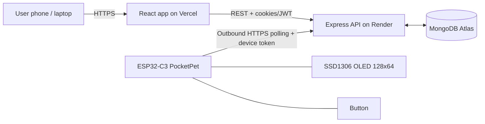
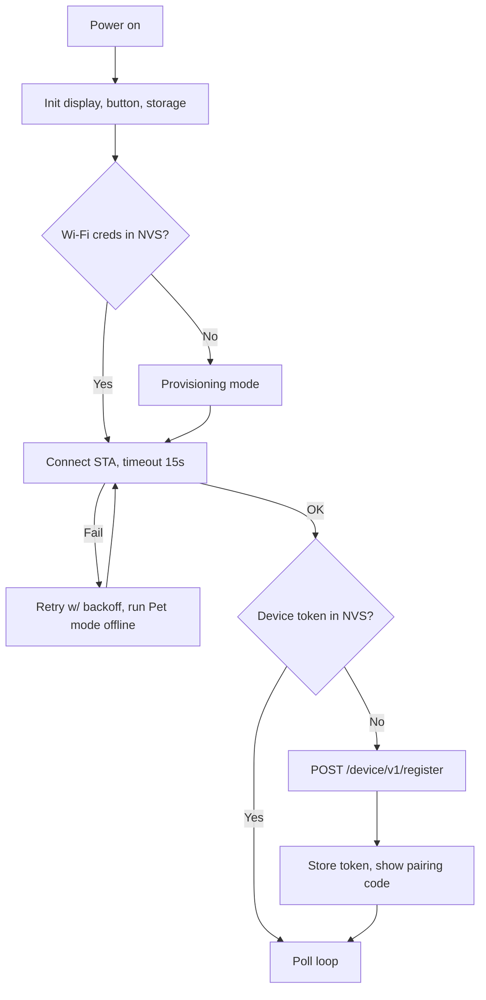
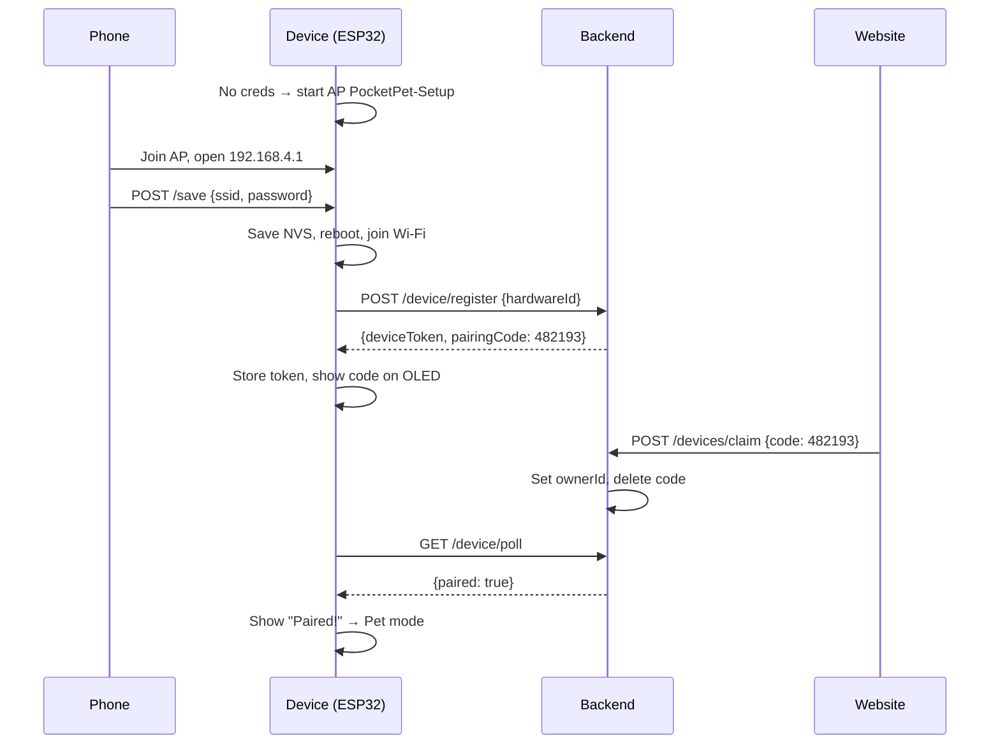
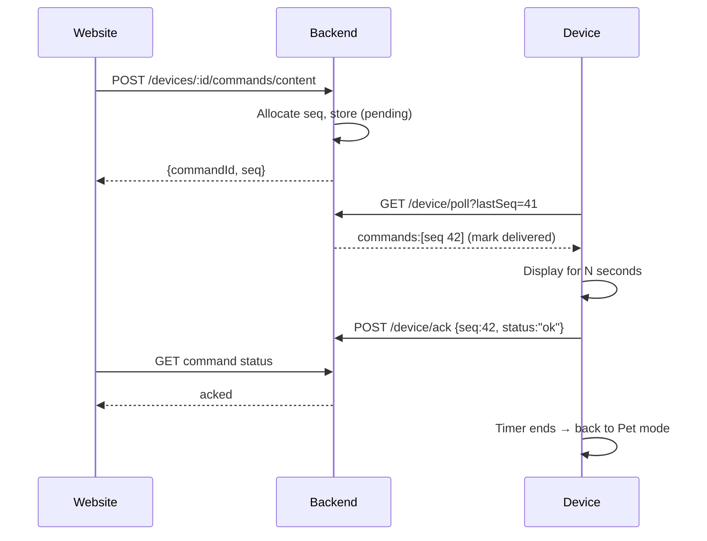
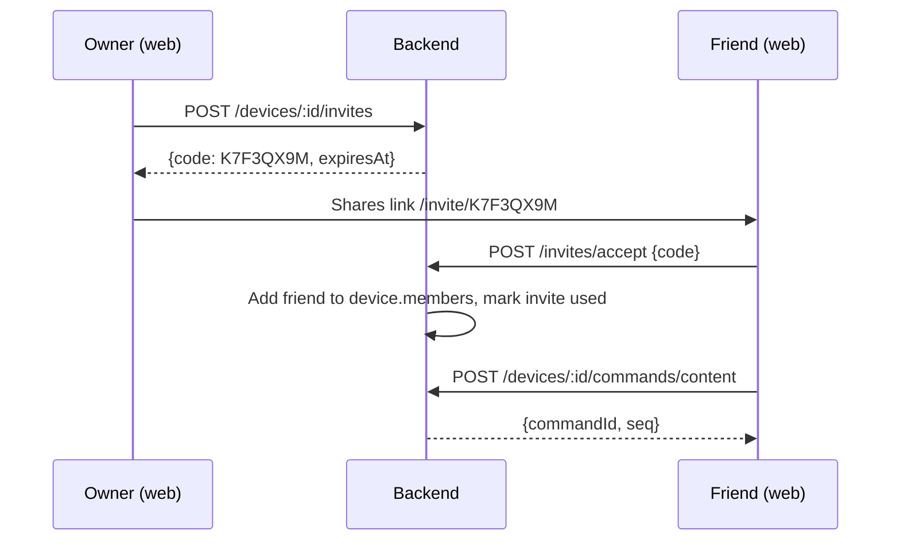
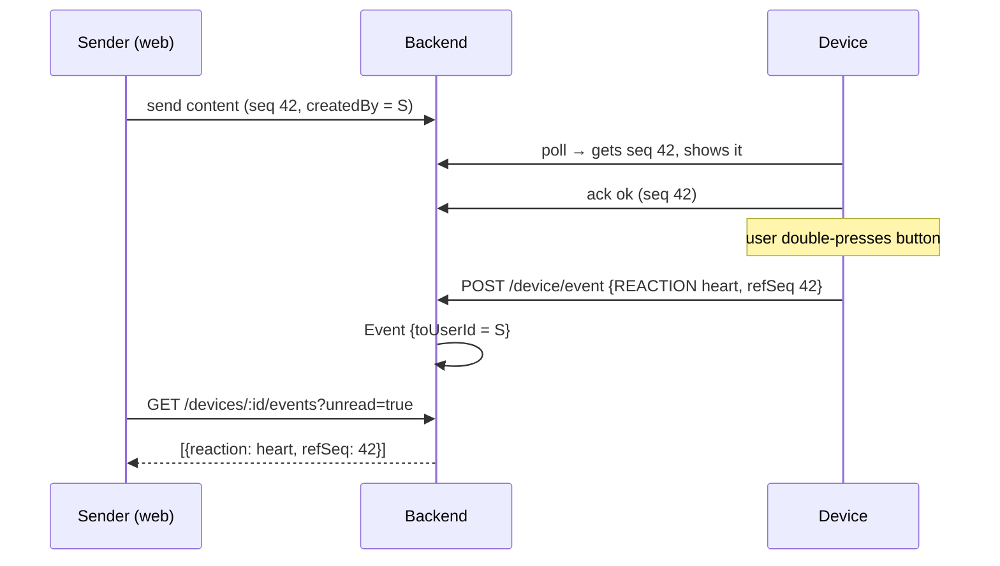

# 🐶 PocketPet

A tiny ESP32-C3 keychain with an OLED screen that shows an animated pixel dog and can receive messages, drawings and playlists **from anywhere in the world** through a web app.

> Status: design phase. This document is the source of truth for architecture and low-level design (LLD). Items marked **[OPEN]** are decisions still to be made.

---

## Table of Contents

1. [Product Overview](#1-product-overview)
2. [Tech Stack](#2-tech-stack)
3. [System Architecture](#3-system-architecture)
4. [Repository Structure](#4-repository-structure)
5. [Hardware Design](#5-hardware-design)
6. [Firmware Low-Level Design](#6-firmware-low-level-design)
7. [Backend Low-Level Design](#7-backend-low-level-design)
8. [Frontend Low-Level Design](#8-frontend-low-level-design)
9. [Key Flows (Sequence Diagrams)](#9-key-flows)
10. [Data Formats](#10-data-formats)
11. [Security Design](#11-security-design)
12. [Reliability & Error Handling](#12-reliability--error-handling)
13. [Deployment](#13-deployment)
14. [Testing Strategy](#14-testing-strategy)
15. [Development Roadmap](#15-development-roadmap)
16. [Future Features](#16-future-features)
17. [Open Questions](#17-open-questions)

---

## 1. Product Overview

### 1.1 What it is
PocketPet is a physical keychain with a 128×64 OLED. It works standalone as a digital pet, and becomes a remote messaging display when connected to Wi-Fi and paired to a user account.

### 1.2 Core features

| # | Feature | Description |
|---|---------|-------------|
| F1 | Pet mode | Dog animations run fully on-device. No internet needed. |
| F2 | Custom content | Send a text message or a pixel drawing; it displays for N seconds, then returns to pet mode. |
| F3 | Playlist mode | Send an ordered list of text/bitmap items with per-item durations. Device stores and plays locally. |
| F4 | Wi-Fi provisioning | First-boot captive portal on the ESP32 to enter home Wi-Fi credentials. |
| F5 | Device pairing | Short code on OLED links a physical device to a user account. |
| F6 | Web dashboard | Online/offline status, last seen, send content, manage playlists, settings. |
| F7 | Pixel editor | In-browser 128×64 monochrome drawing tool and image importer. |
| F8 | Reliability | Command queue, acknowledgements, expiry, auto-reconnect, offline fallback to pet mode. |
| F9 | Sharing | The owner can invite other people (partner, friends) who can then send content to the device. |
| F10 | Reactions | Button gestures on the keychain send a reaction (e.g. ❤) back to the person who sent the content. |
| F11 | Icon set | Built-in pixel icons (heart, bone, paw...) usable inside text via `:heart:` tokens. |

### 1.3 Design principles

1. **The device initiates all connections.** Home routers block inbound traffic; outbound HTTPS always works.
2. **Device renders, cloud stores and delivers.** The cloud never streams pixels. It stores *content* and *commands*.
3. **Device stays useful offline.** Pet mode and stored playlists keep working without internet.
4. **Commands are durable.** Everything lives in MongoDB, never in server memory (Render free tier restarts/spins down).
5. **Small payloads.** A full 128×64 1-bit frame is 1024 bytes; everything is sized for an MCU.

---

## 2. Tech Stack

| Layer | Technology | Notes |
|-------|-----------|-------|
| Firmware | C++ / Arduino framework on ESP32-C3, PlatformIO | U8g2 for display, ArduinoJson, LittleFS, Preferences (NVS) |
| Frontend | React 18 + Vite, React Router, TanStack Query, Zustand, Tailwind CSS | Hosted on **Vercel** |
| Backend | Node.js 20 + Express 4 | Hosted on **Render** |
| Database | MongoDB (Atlas) + Mongoose | Free M0 tier is enough for MVP |
| Validation | Zod (backend and frontend share schemas where possible) | |
| Auth | Email + password, single long-lived JWT (30 days) for users (deliberately simple); opaque per-device tokens for hardware | |
| Device ↔ Cloud | HTTPS polling (MVP) → long-polling → optional WebSocket later | |
| Tooling | ESLint, Prettier, Vitest/Jest, Supertest, GitHub Actions | |

---

## 3. System Architecture

### 3.1 High-level diagram



### 3.2 Components and responsibilities

| Component | Responsibility |
|-----------|----------------|
| **Firmware** | Provisioning portal, Wi-Fi management, cloud client, mode state machine, pet animation, playlist playback, local persistence, button handling |
| **Backend** | User auth, device registration and pairing, command queue, content/playlist storage, device status tracking, rate limiting |
| **Frontend** | Auth UI, device dashboard, pairing, composer, pixel editor, playlist editor, settings |
| **Database** | Users, devices, pairing codes, commands, contents, playlists |

### 3.3 Communication model

The server holds a **per-device ordered command queue**. The device polls, receives pending commands, executes them, and acknowledges. This gives at-least-once delivery with idempotency via a monotonically increasing `seq` per device.

```
Website ──create command──► Backend (status: pending)
                               │
Device ──GET /poll (lastSeq)──►│── returns commands seq > lastSeq (status: delivered)
Device executes + stores
Device ──POST /ack────────────►│── status: acked | failed
Website ◄── GET command status ┘
```

---

## 4. Repository Structure

Monorepo with three packages.

```
PocketPet/
├── README.md
├── docs/
│   ├── api.md                      # Generated/maintained OpenAPI summary
│   ├── bitmap-format.md
│   ├── wiring.md
│   └── images/
├── .github/
│   └── workflows/
│       ├── backend-ci.yml
│       ├── frontend-ci.yml
│       └── firmware-build.yml
│
├── shared/
│   └── icons.json                  # icon names + ids, used by firmware, backend, frontend
├── firmware/
│   ├── platformio.ini
│   ├── data/                       # LittleFS image (portal HTML/CSS/JS)
│   │   └── portal/
│   │       ├── index.html
│   │       └── style.css
│   ├── include/
│   │   ├── config.h                # pins, timings, URLs, limits
│   │   ├── secrets.example.h       # API base URL, CA cert (copy to secrets.h)
│   │   └── types.h                 # shared structs/enums
│   ├── lib/
│   │   ├── sprites/                # dog frames as XBM arrays in PROGMEM
│   │   │   ├── dog_idle.h
│   │   │   ├── dog_walk.h
│   │   │   ├── dog_sleep.h
│   │   │   └── dog_happy.h
│   │   └── icons/                  # 16x16 and 32x32 icon XBMs in PROGMEM
│   │       ├── icons16.h
│   │       └── icons32.h
│   ├── src/
│   │   ├── main.cpp                # setup() / loop(), wires modules
│   │   ├── app_state.cpp/.h        # top-level state machine
│   │   ├── button_manager.cpp/.h   # debounce, short/long/very-long press
│   │   ├── display_manager.cpp/.h  # U8g2 wrapper, screens, text layout
│   │   ├── pet_animation.cpp/.h    # dog behaviour + frame scheduler
│   │   ├── wifi_manager.cpp/.h     # STA connect, reconnect, backoff
│   │   ├── provisioning.cpp/.h     # AP + captive portal + DNS server
│   │   ├── cloud_client.cpp/.h     # register, poll, ack over HTTPS
│   │   ├── command_executor.cpp/.h # validates and applies commands
│   │   ├── content_player.cpp/.h   # single content item + timer
│   │   ├── playlist_manager.cpp/.h # persistent playlist + playback
│   │   ├── storage_manager.cpp/.h  # NVS + LittleFS abstractions
│   │   ├── icon_renderer.cpp/.h    # parses :name: tokens, mixes text + icons
│   │   ├── reaction_manager.cpp/.h # reaction window, sends events to cloud
│   │   └── power_manager.cpp/.h    # battery read, display dimming, sleep
│   └── test/                       # PlatformIO native unit tests
│
├── backend/
│   ├── package.json
│   ├── .env.example
│   ├── src/
│   │   ├── server.js               # bootstraps DB + listens
│   │   ├── app.js                  # express app, middleware, routes
│   │   ├── config/
│   │   │   ├── env.js              # zod-validated env
│   │   │   └── db.js
│   │   ├── models/
│   │   │   ├── User.js
│   │   │   ├── Device.js
│   │   │   ├── PairingCode.js
│   │   │   ├── Command.js
│   │   │   ├── Content.js
│   │   │   ├── Playlist.js
│   │   │   ├── Invite.js
│   │   │   └── Event.js
│   │   ├── routes/
│   │   │   ├── index.js
│   │   │   ├── auth.routes.js
│   │   │   ├── devices.routes.js
│   │   │   ├── contents.routes.js
│   │   │   ├── playlists.routes.js
│   │   │   └── deviceApi.routes.js # endpoints used by the ESP32
│   │   ├── controllers/
│   │   ├── services/
│   │   │   ├── auth.service.js
│   │   │   ├── device.service.js
│   │   │   ├── pairing.service.js
│   │   │   ├── command.service.js
│   │   │   ├── content.service.js
│   │   │   ├── playlist.service.js
│   │   │   ├── sharing.service.js
│   │   │   └── event.service.js
│   │   ├── middleware/
│   │   │   ├── authUser.js         # verifies JWT
│   │   │   ├── authDevice.js       # verifies device token
│   │   │   ├── validate.js         # zod request validation
│   │   │   ├── rateLimit.js
│   │   │   ├── errorHandler.js
│   │   │   └── requestId.js
│   │   ├── validators/             # zod schemas per resource
│   │   ├── utils/
│   │   │   ├── tokens.js           # generate/hash tokens
│   │   │   ├── bitmap.js           # validate base64 1-bit bitmap
│   │   │   ├── asyncHandler.js
│   │   │   └── ApiError.js
│   │   └── jobs/
│   │       └── expireCommands.js   # safety net if TTL is not enough
│   └── tests/
│       ├── unit/
│       └── integration/
│
└── frontend/
    ├── package.json
    ├── vite.config.js
    ├── index.html
    ├── .env.example                # VITE_API_URL
    ├── vercel.json                 # SPA rewrites
    └── src/
        ├── main.jsx
        ├── App.jsx
        ├── routes/                 # route definitions + guards
        ├── pages/
        │   ├── LoginPage.jsx
        │   ├── RegisterPage.jsx
        │   ├── DashboardPage.jsx
        │   ├── PairDevicePage.jsx
        │   ├── DeviceDetailPage.jsx
        │   ├── MembersPage.jsx
        │   ├── InviteAcceptPage.jsx
        │   ├── ComposePage.jsx
        │   ├── EditorPage.jsx
        │   ├── PlaylistsPage.jsx
        │   ├── PlaylistEditorPage.jsx
        │   ├── HistoryPage.jsx
        │   └── SettingsPage.jsx
        ├── components/
        │   ├── layout/
        │   ├── device/             # DeviceCard, StatusBadge, PairingForm, MembersPanel, ReactionFeed
        │   ├── compose/            # TextComposer, IconPicker, DurationPicker
        │   ├── pixel-editor/       # Canvas, Toolbar, ImageImport, Preview
        │   ├── playlist-editor/    # ItemList, ItemRow, Timeline
        │   └── ui/                 # Button, Modal, Toast, Spinner
        ├── pixel-editor/           # pure logic (no React)
        │   ├── bitmapBuffer.js
        │   ├── tools.js
        │   ├── dither.js
        │   ├── pack.js             # 1bpp pack/unpack + base64
        │   └── font5x7.js
        ├── services/
        │   ├── apiClient.js        # axios/fetch wrapper + refresh logic
        │   ├── authApi.js
        │   ├── deviceApi.js
        │   ├── contentApi.js
        │   └── playlistApi.js
        ├── hooks/                  # useDevices, useDevicePolling, useCommandStatus
        ├── store/                  # zustand: authStore, editorStore
        └── utils/
```

---

## 5. Hardware Design

### 5.1 Bill of materials (proposed)

| Part | Spec |
|------|------|
| MCU | ESP32-C3 SuperMini (RISC-V, Wi-Fi, 4 MB flash) |
| Display | 0.96" SSD1306 OLED, 128×64, I²C (addr 0x3C) |
| Input | 1 external tactile button (decided: single button) |
| Power | 3.7 V LiPo (150–500 mAh) + TP4056-class charger with protection |
| Optional | Passive buzzer, vibration motor |

### 5.2 Pin map (SuperMini, adjustable in `config.h`)

| Signal | GPIO |
|--------|------|
| OLED SDA | 5 |
| OLED SCL | 6 |
| Button (external) | 3 (INPUT_PULLUP, other leg to GND) |
| Button (on-board BOOT, dev only) | 9 (same logical button, see below) |
| Battery ADC (via 2× 100k divider) | 0 (ADC1, safe to use with Wi-Fi) |

**About the buttons on the ESP32-C3 SuperMini.** The board has two tiny on-board buttons:

- **RESET (EN):** hardware reset only. Software cannot read it, so it cannot be a user button.
- **BOOT (GPIO9):** a normal input once the sketch is running, so it works as the single button while prototyping. Do not hold it while powering up or resetting, or the chip enters download mode.

For the real keychain, wire an **external** tactile button to GPIO3 (the on-board ones are too small and sit inside the enclosure). Firmware treats GPIO3 and GPIO9 as the same logical button.

> GPIO 2, 8 and 9 are strapping pins on the C3, and GPIO8 drives the on-board LED. That is why I2C moved to GPIO5/6. Verify against your exact board revision before finalising the PCB.

### 5.3 Button gestures

| Gesture | Action |
|---------|--------|
| Short press | Cycle mode: Pet → Playlist (if stored) → Pet; dismiss custom content |
| Double press | Send ❤ reaction (only while content is showing or within the reaction window) |
| Triple press | Send 🙂 reaction (same rules) |
| Long press (3 s) | Open Wi-Fi provisioning mode |
| Very long press (10 s) | Factory reset (wipe NVS + LittleFS), confirm on screen |

---

## 6. Firmware Low-Level Design

### 6.1 Boot flow



### 6.2 Top-level state machine (`app_state`)

| State | Description | Exits |
|-------|-------------|-------|
| `BOOT` | Hardware init | → `PROVISIONING` or `CONNECTING` |
| `PROVISIONING` | AP `PocketPet-Setup`, captive portal | creds saved → `CONNECTING`; 5 min timeout → `CONNECTING` or `PET` |
| `CONNECTING` | Wi-Fi STA connect | OK → `REGISTERING`/`ONLINE`; fail → `OFFLINE_PET` |
| `REGISTERING` | Obtain device token + pairing code | OK → `AWAITING_PAIR` |
| `AWAITING_PAIR` | Shows 6-digit code; polls for paired flag | paired → `ONLINE` |
| `ONLINE` | Normal. Display mode is a sub-state (below) | Wi-Fi lost → `OFFLINE_PET` |
| `OFFLINE_PET` | Pet + stored playlist; background reconnect | reconnected → `ONLINE` |

Display sub-state (orthogonal to connectivity): `PET`, `CONTENT` (single item with timer), `PLAYLIST`.

### 6.3 Module interfaces

```cpp
// storage_manager.h
struct WifiCreds { String ssid; String pass; };
class StorageManager {
 public:
  bool begin();
  bool loadWifi(WifiCreds&);   bool saveWifi(const WifiCreds&);
  String loadDeviceToken();    void saveDeviceToken(const String&);
  uint32_t loadLastSeq();      void saveLastSeq(uint32_t);
  bool savePlaylist(const Playlist&);   bool loadPlaylist(Playlist&);
  void factoryReset();
};

// cloud_client.h
struct PollResult { bool ok; bool paired; String pairingCode;
                    uint16_t pollIntervalSec; std::vector<Command> commands; };
class CloudClient {
 public:
  bool registerDevice(String& tokenOut, String& pairingCodeOut);
  PollResult poll(uint32_t lastSeq, const DeviceStats&);
  bool ack(const std::vector<Ack>&);
};

// command_executor.h
enum class CmdType { SHOW_CONTENT, PLAY_PLAYLIST, STOP, SET_SETTINGS, UNPAIR, REBOOT };
AckStatus execute(const Command&);   // idempotent on seq
```

### 6.4 NVS layout (namespace `pocketpet`)

| Key | Type | Purpose |
|-----|------|---------|
| `wifi_ssid` | string | Home Wi-Fi SSID |
| `wifi_pass` | string | Wi-Fi password (see security note about NVS encryption) |
| `dev_token` | string | Device auth token (64 hex chars) |
| `last_seq` | uint32 | Highest command seq executed |
| `poll_int` | uint16 | Poll interval from server |
| `settings` | blob | brightness, pet skin, timezone offset |

### 6.5 LittleFS layout

```
/portal/index.html       # provisioning page (read-only partition image)
/playlist.json           # active playlist metadata
/pl/0.bin ... /pl/N.bin  # bitmap payloads (1024 bytes each)
```

Limits: max **20 items** per playlist, text ≤ **64 chars**, bitmap = exactly **1024 bytes**. At the maximum, ~20 KB, which fits easily in a 1 MB LittleFS partition.

### 6.6 Provisioning (captive portal)

1. `WiFi.softAP("PocketPet-Setup")` (open network, optional per-device suffix e.g. `PocketPet-Setup-3F9A`).
2. `DNSServer` answers every domain with `192.168.4.1` so phones auto-open the portal.
3. `WebServer` routes:
   - `GET /` → portal page from LittleFS
   - `GET /scan` → JSON list of visible SSIDs (async scan)
   - `POST /save` → `{ssid, password}`; saves to NVS; responds; reboots into STA mode
   - `GET /generate_204`, `/hotspot-detect.html`, `/ncsi.txt` → redirect to `/` (captive portal detection)
4. OLED shows: `Join Wi-Fi: PocketPet-Setup`.
5. Timeout after 5 minutes: if stored creds exist, resume normal boot; otherwise keep waiting.

### 6.7 Wi-Fi manager

- `WiFi.setAutoReconnect(true)`; manual watchdog in `loop()`.
- Backoff on failure: 2 s, 4 s, 8 s, 16 s, 30 s (cap), reset on success.
- During disconnection the device stays in `OFFLINE_PET`; no blocking calls in `loop()`.

### 6.8 Cloud client

**Transport:** `WiFiClientSecure` + `HTTPClient`, TLS 1.2, root CA pinned in `secrets.h` (use the root of Render's certificate chain; do **not** ship `setInsecure()` beyond early prototyping).

**Poll cycle**

```
every pollIntervalSec (default 8s, server-adjustable 5-60s):
  GET /api/v1/device/poll?lastSeq=<n>&fw=<ver>&rssi=<dBm>&bat=<pct>
  headers: Authorization: Bearer <dev_token>
  → 200 { paired, pairingCode?, pollIntervalSec, commands[], serverTime }
  for each command (ascending seq):
      if seq <= last_seq: skip (duplicate)
      result = execute(cmd)
      persist last_seq
  POST /api/v1/device/ack with results
```

**Timeouts:** connect 5 s, read 10 s. Render cold start can take 30–50 s on free tier; on timeout, treat as soft failure, backoff, retry. Never block the display loop (run on a FreeRTOS task pinned separately, or use non-blocking state steps; the C3 is single-core, so keep each step short and call `yield()`).

**Backoff on server errors:** 5xx/timeouts → 10 s, 20 s, 40 s, 60 s cap. `401` → token invalid: wipe token, return to `REGISTERING`.

### 6.9 Pet animation

- Sprites stored as XBM in PROGMEM (e.g. 48×48), rendered with `u8g2.drawXBMP`.
- Behaviours: `IDLE`, `WALK_LEFT`, `WALK_RIGHT`, `SIT`, `SLEEP`, `HAPPY` (on button press or new message arrival), `BARK`.
- Scheduler: non-blocking, `millis()`-based; frame period 120–200 ms; random behaviour switch every 4–12 s with weighted probabilities; `SLEEP` after 60 s of inactivity (display dimmed).
- Notification cue: when a command arrives, show an envelope icon/`HAPPY` for 1 s before content.

### 6.10 Content player

```
showContent(item, durationSec):
  render(item)               // text auto-wrap/center, or drawXBM
  timer = now + duration*1000
  loop: if timer expired OR button pressed → return to previous (PET)
```

Text layout: pick the largest of fonts `[u8g2_font_10x20, 7x14, 6x12, 5x8]` that fits after word-wrapping to 128 px width; if still too long, vertical marquee scroll.

### 6.10a Icon set

Icons are plain pixel glyphs stored in PROGMEM (16×16 = 32 bytes each, 32×32 = 128 bytes each; the whole set is about 2.5 KB).

- Text may contain tokens like `:heart:`. `icon_renderer` splits text into runs of characters and icons.
- Inline icons are 16×16 and sit on the text baseline, so lines that contain icons use a font of height ≤ 16.
- If the message is **only** one icon (e.g. `:heart:`), it is drawn as the 32×32 version, centered.
- Unknown tokens render as literal text.

Initial icon set (16): `heart`, `star`, `bone`, `paw`, `smile`, `sad`, `kiss`, `sun`, `moon`, `coffee`, `music`, `gift`, `cake`, `check`, `bell`, `hug`. The canonical list lives in `shared/icons.json` (name + numeric id) and is used by firmware, backend validation and the frontend picker.

### 6.10b Reactions

- While a content item (or playlist item) is displayed, and for `REACTION_WINDOW_SEC` afterwards, `reaction_manager` remembers the `seq` of the last displayed command.
- Double press sends `heart`, triple press sends `smile`. The device draws a brief animation (dog `HAPPY` + the icon) as local feedback.
- It posts `POST /device/event {type:"REACTION", reaction, refSeq}`. If offline, the event is queued in RAM (max 5) and retried; events older than 10 minutes are dropped.
- Reactions are routed by the backend to whoever created that command, so with sharing each sender gets reactions to *their* messages.
- "Seen" needs no gesture: the ack with status `ok` already means "displayed", and the web UI shows it.

### 6.11 Playlist manager

- On `PLAY_PLAYLIST`: download is inline in the command payload; items are written to LittleFS; `playlist.json` stores `{id, repeat, items[{type, text?, file?, duration}]}`.
- Playback is index-based and survives reboots only if `repeat=true` (otherwise plays once then returns to pet).
- A button press during playback skips to next item; long press stops.

### 6.12 Power management

- Poll interval stretches (up to 30 s) when no command has arrived for 10 min **[OPEN: tradeoff vs. latency]**.
- OLED dims after 20 s of Pet mode, off after 60 s; button wakes.
- Wi-Fi modem sleep enabled (`WiFi.setSleep(true)`).
- Battery read every 60 s via ADC divider; reported in poll.
- Future: deep sleep with timer wake + long-poll tradeoffs.

### 6.13 Firmware config constants (`config.h`)

```cpp
#define OLED_W 128
#define OLED_H 64
#define POLL_DEFAULT_SEC 8
#define POLL_MIN_SEC 5
#define POLL_MAX_SEC 60
#define MAX_PLAYLIST_ITEMS 20
#define MAX_TEXT_LEN 64
#define BITMAP_BYTES 1024
#define BTN_LONG_MS 3000
#define BTN_RESET_MS 10000
#define BTN_MULTI_GAP_MS 350        // max gap between taps for double/triple
#define REACTION_WINDOW_SEC 60      // reactions allowed this long after content starts
#define PORTAL_TIMEOUT_MS 300000
```

---

## 7. Backend Low-Level Design

### 7.1 Request pipeline

```
request → requestId → helmet → cors(allowlist: Vercel domain) → json(limit 64kb)
        → rateLimit → router → [authUser | authDevice] → validate(zod) → controller → service → model
        → errorHandler (uniform JSON error)
```

### 7.2 Environment variables (`.env.example`)

```
NODE_ENV=production
PORT=8080
MONGODB_URI=mongodb+srv://...
JWT_SECRET=...
JWT_TTL=30d
FRONTEND_ORIGIN=https://pocketpet.vercel.app
DEVICE_POLL_DEFAULT_SEC=8
PAIRING_CODE_TTL_MIN=10
COMMAND_TTL_MIN=60
```

### 7.3 Data models (Mongoose)

#### User
```js
{
  _id: ObjectId,
  email: { type: String, unique: true, lowercase: true, index: true },
  passwordHash: String,          // bcrypt cost 12 (or argon2id)
  displayName: String,
  createdAt, updatedAt
}
```

#### Device
```js
{
  _id: ObjectId,
  hardwareId: { type: String, unique: true },   // from ESP32 MAC, e.g. "pp-A1B2C3D4E5F6"
  name: { type: String, default: "My PocketPet" },
  ownerId: { type: ObjectId, ref: "User", index: true, default: null }, // null = unclaimed
  members: [{                                   // people who may send content (owner is NOT listed here)
    userId: { type: ObjectId, ref: "User", index: true },
    role: { type: String, enum: ["sender"], default: "sender" },
    addedAt: Date
  }],
  tokenHash: String,                            // sha256 of device token
  claimedAt: Date,
  nextSeq: { type: Number, default: 1 },        // atomic per-device command counter
  status: {
    lastSeenAt: Date,
    rssi: Number, battery: Number, fwVersion: String,
    currentMode: { type: String, enum: ["pet","content","playlist","unknown"] },
    lastAckedSeq: Number
  },
  settings: {
    pollIntervalSec: { type: Number, default: 8 },
    brightness: { type: Number, default: 255 },
    petSkin: { type: String, default: "default" },
    timezone: String
  },
  createdAt, updatedAt
}
```
`online` is **derived**: `now - lastSeenAt < 2.5 × pollIntervalSec`.

#### PairingCode
```js
{
  deviceId: ObjectId,
  code: { type: String, index: true },          // 6 digits
  expiresAt: { type: Date, index: { expireAfterSeconds: 0 } }, // TTL
  attempts: { type: Number, default: 0 }
}
```
Unique partial index on `code` for non-expired entries to prevent collisions.

#### Command
```js
{
  _id: ObjectId,
  deviceId: { type: ObjectId, index: true },
  seq: Number,                                  // unique per device
  type: { enum: ["SHOW_CONTENT","PLAY_PLAYLIST","STOP","SET_SETTINGS","UNPAIR","REBOOT"] },
  payload: Object,
  status: { enum: ["pending","delivered","acked","failed","expired"], default: "pending" },
  createdBy: ObjectId,
  createdAt: Date,
  deliveredAt: Date, ackedAt: Date,
  attempts: { type: Number, default: 0 },
  error: String,
  expiresAt: Date                                // message expiry: not shown if stale
}
// indexes:
//  { deviceId: 1, seq: 1 } unique
//  { deviceId: 1, status: 1, seq: 1 }  (poll query)
//  { expiresAt: 1 } TTL-ish cleanup (30 days after expiry for history)
```

#### Content (saved library items)
```js
{
  ownerId: ObjectId,
  type: { enum: ["text","bitmap"] },
  title: String,
  text: String,                  // type=text, max 64 chars
  bitmapB64: String,             // type=bitmap, exactly 1024 bytes decoded
  createdAt
}
```

#### Playlist
```js
{
  ownerId: ObjectId,
  name: String,
  repeat: Boolean,
  items: [{
    type: { enum: ["text","bitmap"] },
    text: String,
    bitmapB64: String,
    durationSec: { type: Number, min: 1, max: 600 }
  }],                            // max 20 items
  createdAt, updatedAt
}
```

#### Invite
```js
{
  deviceId: ObjectId,
  code: { type: String, unique: true },         // 8 chars, e.g. "K7F3QX9M"
  createdBy: ObjectId,                          // must be the device owner
  expiresAt: { type: Date, index: { expireAfterSeconds: 0 } },  // TTL, 48 h
  usedBy: ObjectId, usedAt: Date                // single use
}
```

#### Event (device → web: reactions)
```js
{
  deviceId: { type: ObjectId, index: true },
  type: { enum: ["REACTION"] },
  reaction: { enum: ["heart", "smile"] },       // extensible
  refSeq: Number,                               // which command was being shown
  toUserId: { type: ObjectId, index: true },    // command.createdBy
  createdAt: Date,
  readAt: Date                                  // null until the recipient opens it
}
// index: { toUserId: 1, readAt: 1, createdAt: -1 }
```

### 7.4 REST API (v1)

Base: `/api/v1`. All responses are JSON. Errors: `{ "error": { "code": "STRING", "message": "…", "details": [] } }`.

#### 7.4.1 Auth (user)

| Method | Path | Body | Response |
|--------|------|------|----------|
| POST | `/auth/register` | `{email, password, displayName}` | `201 {user, token}` |
| POST | `/auth/login` | `{email, password}` | `200 {user, token}` (JWT, 30 days) |
| GET | `/me` | | `200 {user}` |

Logout is client-side (discard the token). No refresh tokens: this is intentionally simple for a personal project. Passwords are still hashed with bcrypt.

#### 7.4.2 Devices (user, JWT required)

| Method | Path | Description |
|--------|------|-------------|
| GET | `/devices` | List the user's devices with derived `online` |
| POST | `/devices/claim` | `{code, name?}` → pair a device |
| GET | `/devices/:id` | Device detail + status |
| PATCH | `/devices/:id` | Rename, update settings (enqueues `SET_SETTINGS`) |
| DELETE | `/devices/:id` | Owner only: unpair (enqueues `UNPAIR`, clears owner) |
| GET | `/devices/:id/members` | Owner + senders |
| POST | `/devices/:id/invites` | Owner only: create invite `{code, expiresAt}` |
| POST | `/invites/accept` | `{code}` → current user becomes a `sender` of that device |
| DELETE | `/devices/:id/members/:userId` | Owner removes a sender (a sender may remove themselves) |
| GET | `/devices/:id/events?unread=true` | Reactions addressed to the current user |
| POST | `/devices/:id/events/read` | `{ids[]}` mark reactions as read |
| POST | `/devices/:id/commands/content` | `{type, text? \| bitmapB64?, durationSec, expiresInSec?}` → `SHOW_CONTENT` |
| POST | `/devices/:id/commands/playlist` | `{playlistId}` or inline `{items, repeat}` → `PLAY_PLAYLIST` |
| POST | `/devices/:id/commands/stop` | `STOP` (return to pet) |
| GET | `/devices/:id/commands?limit=&cursor=` | Command history with statuses |
| GET | `/devices/:id/commands/:cmdId` | Single command status (for UI "delivered/displayed" ticks) |

#### 7.4.3 Library

| Method | Path |
|--------|------|
| GET/POST | `/contents` |
| GET/PATCH/DELETE | `/contents/:id` |
| GET/POST | `/playlists` |
| GET/PUT/DELETE | `/playlists/:id` |

#### 7.4.4 Device API (device token required)

| Method | Path | Body / Query | Response |
|--------|------|--------------|----------|
| POST | `/device/register` | `{hardwareId, fwVersion}` (no auth, rate-limited) | `{deviceToken, pairingCode, expiresAt, pollIntervalSec}` |
| POST | `/device/pairing-code` | (auth) refresh an expired code | `{pairingCode, expiresAt}` |
| GET | `/device/poll` | `?lastSeq&fw&rssi&bat&mode` | `{paired, pairingCode?, pollIntervalSec, commands[], serverTime}` |
| POST | `/device/ack` | `{acks:[{seq, status:"ok"\|"error", error?}]}` | `204` |

**Device events**

| Method | Path | Body | Response |
|--------|------|------|----------|
| POST | `/device/event` | `{type:"REACTION", reaction:"heart"\|"smile", refSeq}` | `204` |

The backend verifies that `refSeq` belongs to this device and is less than 10 minutes old, sets `toUserId = command.createdBy`, and stores an `Event`. Rate limit: 10/min per device.

**Register idempotency:** if `hardwareId` exists and is unclaimed, a new token is issued (old one invalidated). If it is already claimed, registration is rejected (`409 DEVICE_ALREADY_CLAIMED`) unless the owner has unpaired it. This prevents someone hijacking a paired device by spoofing its hardware ID.

#### 7.4.5 Example command payloads

```json
// SHOW_CONTENT
{ "seq": 42, "type": "SHOW_CONTENT",
  "payload": { "kind": "text", "text": "MISS YOU", "durationSec": 30 },
  "expiresAt": "2026-11-16T12:30:00Z" }

// PLAY_PLAYLIST
{ "seq": 43, "type": "PLAY_PLAYLIST",
  "payload": { "playlistId": "pl_9x", "repeat": false,
    "items": [
      {"kind":"text","text":"Hey you!","durationSec":3},
      {"kind":"bitmap","bitmapB64":"<1368 chars>","durationSec":5}
    ] } }

// SET_SETTINGS
{ "seq": 44, "type": "SET_SETTINGS", "payload": { "brightness": 120, "pollIntervalSec": 10 } }
```

### 7.5 Key service logic

**Atomic seq allocation**
```js
const dev = await Device.findOneAndUpdate(
  { _id: deviceId, ownerId: userId },
  { $inc: { nextSeq: 1 } },
  { new: true }
);
const seq = dev.nextSeq - 1;
await Command.create({ deviceId, seq, type, payload, expiresAt });
```

**Poll handler**
```
1. authDevice: sha256(token) → Device (reject if not found)
2. update status (lastSeenAt, rssi, battery, fw, mode) — single $set, throttled writes ok
3. if device.ownerId == null → return { paired:false, pairingCode (ensure valid), commands: [] }
4. mark commands with seq <= lastSeq as acked-if-delivered (device confirms by lastSeq)
5. expire: updateMany({deviceId, status in [pending,delivered], expiresAt < now}, status=expired)
6. find({deviceId, seq > lastSeq, status in [pending, delivered]}).sort(seq).limit(5)
7. mark returned as delivered (attempts++, deliveredAt)
8. return commands + pollIntervalSec
```

**Ack handler:** set `acked`/`failed`, `ackedAt`, update `status.lastAckedSeq`. Idempotent.

**Claim handler**
```
1. find PairingCode by code (not expired), attempts < 5
2. on mismatch: increment attempts for IP-based limiter (rate limit 5/min/user)
3. set Device.ownerId = user._id, claimedAt = now
4. delete PairingCode
5. return device
```

**Unpair:** enqueue `UNPAIR` command, set `ownerId = null` after the device acks (or after 24 h). Device wipes the token and returns to registration.

### 7.6 Rate limits

| Scope | Limit |
|-------|-------|
| Global per IP | 300 / 15 min |
| `/auth/*` | 10 / 15 min per IP |
| `/devices/claim` | 5 / min per user |
| `/device/register` | 10 / hour per IP |
| `/device/poll` | 20 / min per device token |
| Content sends | 30 / min per user |

### 7.7 Logging & observability

- `pino` structured logs with `requestId`.
- `/healthz` (liveness) and `/readyz` (DB check) endpoints. Use `/healthz` for an uptime pinger to reduce Render cold starts.
- Metrics later: online devices, command latency (created → acked).

### 7.8 Sharing, roles & reactions

**Roles**

| Action | Owner | Sender |
|--------|:----:|:-----:|
| View device status | ✅ | ✅ |
| Send content / start playlist / stop | ✅ | ✅ |
| Use own saved library and playlists | ✅ | ✅ |
| Change settings, rename | ✅ | ❌ |
| Invite / remove senders | ✅ | ❌ (can leave) |
| Unpair device | ✅ | ❌ |
| See command history | all commands | only own commands |

**Authorization helper** (used by every `/devices/:id/*` route):
```js
// returns {device, role} or throws 403/404
async function getDeviceAccess(deviceId, userId) {
  const d = await Device.findById(deviceId);
  if (!d) throw new ApiError(404, "DEVICE_NOT_FOUND");
  if (String(d.ownerId) === String(userId)) return { device: d, role: "owner" };
  if (d.members.some(m => String(m.userId) === String(userId))) return { device: d, role: "sender" };
  throw new ApiError(404, "DEVICE_NOT_FOUND");   // 404, not 403, to avoid leaking existence
}
```

**Invite flow:** owner calls `POST /devices/:id/invites` → gets an 8-character code (48 h, single use) → shares it (or a link `https://<site>/invite/<code>`) → friend logs in and accepts → added to `members`.

**Sender identity on the device:** `SHOW_CONTENT` payload includes `fromName`. If the sender is not the owner, the OLED shows a small `from <name>` header (first 10 chars) for the first 2 seconds. Setting `showSender` (default true) can turn this off.

**Reaction delivery:** device → `POST /device/event` → `Event` document → the web app polls `GET /devices/:id/events?unread=true` together with the device list (every 10 s) and shows a badge plus an entry like "❤ from <device name> on your message 'MISS YOU'" in the history. Browser/phone push notifications are a later PWA feature.

---

## 8. Frontend Low-Level Design

### 8.1 Routes

| Route | Page | Auth |
|-------|------|------|
| `/login`, `/register` | Auth | public |
| `/` | Dashboard (device cards) | ✅ |
| `/pair` | Enter 6-digit code | ✅ |
| `/devices/:id` | Device detail, status, quick send, history, reactions | ✅ |
| `/devices/:id/members` | Members, invites, roles | ✅ |
| `/invite/:code` | Accept an invite | ✅ |
| `/devices/:id/compose` | Compose text/bitmap | ✅ |
| `/editor` , `/editor/:contentId` | Pixel editor | ✅ |
| `/playlists`, `/playlists/:id` | Playlist list / editor | ✅ |
| `/settings` | Account + device settings | ✅ |

### 8.2 State management

| Concern | Tool |
|---------|------|
| Server data (devices, playlists, commands) | TanStack Query (cache, refetch, polling) |
| Auth session | Zustand `authStore`, token persisted in `localStorage` |
| Editor state (bitmap buffer, tool, undo stack) | Zustand `editorStore` |
| Forms | React Hook Form + Zod |

### 8.3 API client

- Axios instance with `baseURL = import.meta.env.VITE_API_URL`.
- Request interceptor attaches `Authorization: Bearer <token>` from `authStore`.
- Response interceptor: on `401`, clear the token and redirect to `/login`.

### 8.4 Key components

| Component | Props / behaviour |
|-----------|-------------------|
| `DeviceCard` | name, online badge, last seen ("12 s ago"), battery, quick actions |
| `StatusBadge` | derived from `lastSeenAt`; polls `/devices` every 10 s |
| `PairingForm` | 6-digit input with auto-advance; shows server errors |
| `TextComposer` | counter (64), live OLED preview (canvas using the same font metrics), duration slider |
| `IconPicker` | grid of the 16 icons rendered from `shared/icons.json`; click inserts `:name:` at the cursor; the preview draws them inline |
| `MembersPanel` | list of senders, create/copy invite link, remove member |
| `ReactionFeed` | unread reactions with the original message, mark-as-read |
| `CommandStatusTicker` | shows `Sent → Delivered → Displayed` by polling a command until terminal state |
| `PixelCanvas` | 128×64 logical grid, zoom 4–10×, pointer events, touch support |
| `Toolbar` | pencil, eraser, line, rectangle, ellipse, fill, invert, clear, undo/redo |
| `ImageImport` | file → scale to 128×64 → threshold / Floyd–Steinberg dither → buffer |
| `OledPreview` | black/blue (or white) pixel render of a bitmap exactly as device would show it |
| `PlaylistItemRow` | drag handle, type icon, preview, duration input, remove |
| `Timeline` | total playlist runtime |

### 8.5 Pixel editor logic (pure JS in `src/pixel-editor/`)

```js
// bitmapBuffer.js
class BitmapBuffer {
  constructor() { this.data = new Uint8Array(1024); }   // 128*64/8
  get(x, y)  { return (this.data[y * 16 + (x >> 3)] >> (x & 7)) & 1; }
  set(x, y, v) {
    const i = y * 16 + (x >> 3), m = 1 << (x & 7);
    v ? (this.data[i] |= m) : (this.data[i] &= ~m);
  }
}
```

- **Undo/redo:** snapshot stack of up to 50 buffers (1 KB each; cheap), push on pointer-up.
- **Drawing:** Bresenham line, midpoint ellipse, scanline flood fill.
- **Export:** `pack.js` → `btoa(String.fromCharCode(...data))` (1368 base64 chars).
- **Import:** draw image to offscreen canvas 128×64 → grayscale → threshold slider or error-diffusion dither → buffer.
- **Text tool:** 5×7 bitmap font rendering into the buffer (**[OPEN: supported character set, emoji]**).

### 8.6 Command status UX

After "Send":
1. `POST` returns `{commandId, seq, status:"pending"}`.
2. UI polls `GET /devices/:id/commands/:cmdId` every 2 s (max 2 minutes).
3. Shows ✔ delivered, ✔✔ displayed (acked), or ⚠ expired/failed, with retry.

### 8.7 Environment & hosting

`VITE_API_URL=https://pocketpet-api.onrender.com/api/v1`. `vercel.json` rewrites all paths to `index.html`. Backend CORS allows only the Vercel production and preview domains.

---

## 9. Key Flows

### 9.1 First-time setup and pairing



### 9.2 Sending a message



### 9.3 Wi-Fi change

Long-press (3 s) → AP mode → new creds saved → reconnect. Device token is preserved, so no re-pairing.

### 9.4 Unpair / factory reset

- Web unpair: `UNPAIR` command → device wipes token → re-registers → new pairing code.
- Hardware factory reset (10 s hold): wipes NVS + LittleFS; backend still thinks it's owned until the owner unpairs from the web **[OPEN: how to handle ownership recovery]**.

### 9.5 Inviting a friend



### 9.6 Reaction back to the sender



---

## 10. Data Formats

### 10.1 Bitmap format (canonical)

- 128 × 64 pixels, 1 bit per pixel, **1024 bytes**.
- Row-major, 16 bytes per row, **LSB = leftmost pixel** (matches U8g2 `drawXBM`).
- Index of pixel `(x, y)`: byte `y*16 + (x>>3)`, bit `x & 7`. `1` = pixel on.
- Transport: standard base64 (1368 chars, with padding). Backend validates decoded length == 1024.

### 10.2 Text rules

- Max 64 characters **counting each `:icon:` token as 1 character**, printable ASCII (0x20–0x7E) otherwise. Emoji are not supported; use the icon set.
- Icon tokens match `:[a-z0-9_]+:` and must be in `shared/icons.json` (backend rejects unknown names with `400 UNKNOWN_ICON`).
- Example: `Miss you :heart: call me :paw:`
- `\n` allowed (max 4 lines).

### 10.3 Time

All server timestamps are ISO-8601 UTC. Devices use `serverTime` from poll (no NTP needed for MVP; durations are relative).

---

## 11. Security Design

| Threat | Mitigation |
|--------|-----------|
| Someone controls your device by guessing the ID | Ownership check on every command; pairing code needed to claim |
| Invite code guessing | 8-char random code, single use, 48 h TTL, accept endpoint rate-limited |
| Pairing code brute force | 6 digits, 10 min TTL, 5 attempts per code, per-user rate limit, one-time use |
| Stolen device token | Stored hashed (SHA-256) server-side; revocable by unpair; TLS only |
| Spoofed hardware ID re-registering | Claimed devices cannot re-register without owner unpairing |
| Password leaks | bcrypt/argon2id, never logged; Wi-Fi password never leaves the device |
| Token theft | Simplified on purpose: 30-day JWT in `localStorage`, CORS allowlist, no third-party scripts on the site |
| Abuse/spam | Rate limits, payload size limits, text/bitmap validation |
| NoSQL injection | Zod validation, `express-mongo-sanitize`, no raw query objects from clients |
| MITM on device | TLS with pinned root CA |
| Physical device theft (reads NVS) | Enable ESP32 flash/NVS encryption in production **[OPEN]** |
| Content abuse (if sharing is added) | Not applicable for MVP; owner-only sending |

---

## 12. Reliability & Error Handling

| Scenario | Behaviour |
|----------|-----------|
| Render cold start | Device timeouts are 10 s per attempt with backoff; commands remain durable; optional uptime pinger on `/healthz` |
| Wi-Fi drops | Device keeps Pet mode / stored playlist, reconnects with backoff |
| Duplicate delivery | Device ignores `seq <= last_seq` |
| Ack lost | Command remains `delivered`; next poll's `lastSeq` implicitly acks it |
| Stale message | `expiresAt` check on server and on device (using serverTime delta) |
| Corrupt bitmap | Device validates length and rejects with `ack error` |
| Storage full | Reject playlist with `ack error: STORAGE_FULL` |
| Firmware crash loop | Watchdog; after 3 consecutive reboots, boot into safe Pet mode |

**Command lifecycle**

```
pending ──poll──► delivered ──ack ok──► acked
   │                  │ └─ack error──► failed
   └────expires───────┴──────────────► expired
```

---

## 13. Deployment

### 13.1 MongoDB Atlas
Free M0 cluster, IP allowlist `0.0.0.0/0` (Render free tier has dynamic IPs) with a strong DB user password.

### 13.2 Backend on Render
- Web Service, root `backend/`, build `npm ci`, start `node src/server.js`.
- Add env vars from §7.2. Health check path `/healthz`.
- Free tier spins down after ~15 min idle; first request can take ~30-50 s. Mitigations: uptime pinger every 10 min, or upgrade to the paid instance (recommended once a device is "always on" in daily use).

### 13.3 Frontend on Vercel
- Root `frontend/`, framework Vite, set `VITE_API_URL`.
- Add the Vercel domain to the backend `FRONTEND_ORIGIN` allowlist.

### 13.4 Firmware
- `pio run -t upload` and `pio run -t uploadfs` (portal page).
- Version string injected via build flag `-DFW_VERSION=\"1.0.0\"`.
- OTA updates (future): backend serves signed firmware URL via a `UPDATE_FIRMWARE` command.

### 13.5 CI (GitHub Actions)
- Backend: lint + tests with `mongodb-memory-server`.
- Frontend: lint + build + tests.
- Firmware: `pio run` build check + native unit tests.

---

## 14. Testing Strategy

| Area | Approach |
|------|----------|
| Backend unit | Services: seq allocation, pairing, expiry |
| Backend integration | Supertest against in-memory Mongo: full pairing flow, poll/ack lifecycle, auth rotation |
| Device simulator | Node script `backend/scripts/fake-device.js` that registers, polls and acks, so the web app can be built **before** hardware is ready |
| Frontend | Vitest + React Testing Library; pure-logic tests for bitmap packing, dithering, flood fill |
| Firmware | PlatformIO native tests for the command parser, playlist serialization, backoff |
| End-to-end | Playwright: register → pair (with simulator) → send → see "displayed" |
| Manual hardware | Checklist: provisioning on iOS/Android, router change, Wi-Fi drop, cold start behaviour |

---

## 15. Development Roadmap

| Phase | Deliverable | Exit criteria |
|-------|-------------|---------------|
| 0 | Repo, CI, env setup | Monorepo builds |
| 1 | Firmware: OLED, dog animation, button modes | Pet runs, short/long press work |
| 2 | Firmware: Wi-Fi provisioning portal | Phone joins AP, creds persist across reboot |
| 3 | Backend: auth, device register, pairing, poll/ack + fake-device script | Integration tests pass |
| 4 | Frontend: auth, dashboard, pair page | Real device shows code, claim works |
| 5 | Cloud → device text messages | Message appears on OLED, ack visible on web |
| 6 | Pixel editor + bitmap send | Drawing shown identically on OLED and preview |
| 7 | Playlists (editor + device playback + persistence) | Plays offline after reboot |
| 8 | Icon set, sharing (invites, roles), reactions | Friend can send; double-press shows ❤ on the sender's dashboard |
| 9 | Hardening: TLS pinning, reconnect, power, enclosure | 24 h soak test OK |

---

## 16. Future Features

- Long-polling or WebSocket for near-instant delivery.
- Shared devices (gift a keychain; multiple senders with permissions).
- Scheduled messages ("Good morning" at 8:00).
- Reactions: button press on the device sends a "❤" back to the sender's dashboard.
- Pet growth/personality (mood changes based on messages received).
- Mobile PWA with push notifications.
- Animated GIF-like frame sequences.
- OTA firmware updates.
- Multiple pet skins from a catalogue.

---

## 17. Open Questions

See the questions asked alongside this document. Record decisions here once made:

| # | Question | Decision |
|---|----------|----------|
| 1 | One button or two? | **One** external button (GPIO3); on-board BOOT (GPIO9) mirrors it for dev |
| 2 | Single owner per device, or multiple senders? | **Sharing supported**: owner + invited senders |
| 3 | Reply/reaction from device to web? | **Yes**: double press ❤, triple press 🙂 |
| 4 | Text character set / emoji support | ASCII + **built-in icon set** (`:heart:` tokens) |
| 5 | Polling interval vs. battery life target | _TBD_ (default 8 s) |
| 6 | Auth: email+password only, or Google sign-in as well? | **Email + password**, simple 30-day JWT |
| 7 | Always-on backend (paid) vs. free tier with cold starts | **Free tier is OK** for now |
| 8 | Ownership recovery after hardware factory reset | _TBD_ |
| 9 | Should shared senders see each other's messages in history? | _TBD_ (currently: no, own only) |
| 10 | Which extra reactions beyond ❤ and 🙂? | _TBD_ |

---

## License

MIT (proposed).
