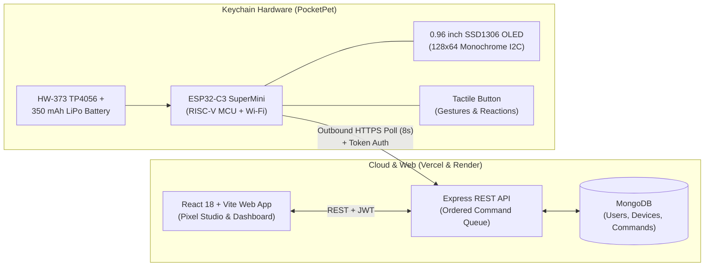

# 🐶 PocketPet

<div align="center">

**A tiny ESP32-C3 keychain pet with a 128×64 OLED display that receives pixel art, messages, and animations from anywhere in the world.**

[](#-hardware-architecture)
[](#-tech-stack)
[](#-tech-stack)
[](#-tech-stack)
[](#-license)

[📖 Quick Setup Guide](./SETUP.md) • [📐 System Architecture](./docs/ARCHITECTURE.md) • [🎨 Product Design Spec](./DESIGN.md) • [🔌 Wiring Diagram](./docs/wiring.md)

</div>

---

## 🌟 What is PocketPet?

**PocketPet** is a standalone physical companion that clips to your backpack or keys. Out of the box, it plays smooth on-device pixel dog animations (idle, walk, happy, sleep). When connected to Wi-Fi, it becomes an internet-connected remote canvas:

- **Send messages from your phone or laptop**: Type a message with built-in pixel emojis (`:heart:`, `:star:`, `:bone:`, `:paw:`). It pops up on the keychain within seconds.
- **Draw live pixel art**: The built-in in-browser 128×64 drawing studio lets you pencil, fill, dither photos, and broadcast drawings directly to the OLED display.
- **Offline first**: Works completely standalone without an internet connection. If Wi-Fi drops, it gracefully stays in Pet mode or plays cached playlists.
- **Interactive replies**: Double-press the physical button on the keychain while reading a message to send a live **❤️ Heart reaction** back to your friend's web dashboard!

---

## 🏗️ System Architecture



### Communication Model
The device initiates **outbound HTTPS polling** with monotonic sequence IDs (`seq`). This bypasses home router NAT/firewalls with zero network configuration.
1. Web creates command (`pending`).
2. Keychain polls `GET /api/v1/device/poll?lastSeq=...` (`delivered`).
3. Screen displays text or bitmap for duration.
4. Keychain sends `POST /api/v1/device/ack` (`acked` = displayed).
5. User presses button twice ➔ `POST /api/v1/device/event` ➔ Heart reaction pops up in real-time on web dashboard.

---

## ✨ Features at a Glance

| Feature | Description |
| :--- | :--- |
| **🐕 Pet Animation Mode** | Non-blocking frame scheduler rendering idle, walking, sleeping, and happy dog sprites on-device. |
| **🎨 128×64 Pixel Art Studio** | Full web canvas with pencil, eraser, lines, shapes, flood fill, 50-step undo/redo, 1:1 hardware preview, and Floyd-Steinberg photo dithering. |
| **💬 Message Composer** | 64-character text composer with automatic font size scaling and 16 built-in pixel glyphs (`:heart:`, `:bone:`, `:paw:`, etc.). |
| **📶 Captive Portal Wi-Fi** | On first boot or 3-second hold, the ESP32 starts an AP (`PocketPet-Setup`) and captive portal to enter home Wi-Fi details. |
| **🔢 6-Digit Pairing** | A simple 6-digit code on the OLED links the physical hardware to any user account. |
| **❤️ Push Reactions** | Double-press the keychain button to send a heart reaction back to the sender's dashboard. |
| **🎶 Ordered Playlists** | Create local slideshows of text slides and bitmap drawings with custom durations and indefinite looping. |
| **👥 Friends & Sharing** | Generate 8-character single-use invite links to let partners or friends send content to your keychain. |
| **🖥️ Hardware Simulator** | Included Node.js terminal simulator allows testing the entire system before assembling hardware! |

---

## 🛠️ Tech Stack

```
PocketPet/
├── firmware/         # C++ / Arduino on ESP32-C3 SuperMini (PlatformIO, U8g2, LittleFS)
├── backend/          # Node.js 20, Express 4, MongoDB, Mongoose, Zod, Vitest
├── frontend/         # React 18, Vite, Tailwind CSS, TanStack Query, Zustand, Lucide
├── shared/           # Canonical shared assets (icons.json)
└── docs/             # Architecture, circuit wiring, and API reference
```

| Layer | Technologies | Notes |
| :--- | :--- | :--- |
| **Firmware** | C++ (Arduino Framework), PlatformIO, ESP32-C3 | U8g2 for SSD1306, LittleFS for portal files, Preferences (NVS) |
| **Backend** | Node.js 20, Express, MongoDB Atlas, Mongoose, Zod | Monotonic sequence queues, bcrypt, 30-day JWTs, Pino logs |
| **Frontend** | React 18, Vite, Tailwind CSS, TanStack Query, Zustand | Pure JS 1bpp bitmap engine, responsive mobile & desktop UI |
| **Hardware** | ESP32-C3 SuperMini, 0.96" OLED, HW-373 TP4056, 350mAh LiPo | Direct pin-to-pin wiring, single-button multi-gesture control |

---

## ⚡ Quick Start

### 1. Backend Setup
```powershell
cd backend
npm install
npm run seed     # Creates demo user: demo@pocketpet.dev / password123
npm start        # Starts API server on http://localhost:8080/api/v1
```

### 2. Frontend Web App
```powershell
cd frontend
npm install
npm run dev      # Launches web app on http://localhost:5173
```

### 3. Test without hardware (Simulator)
```powershell
cd backend
npm run simulate # Emulates an ESP32-C3 in your terminal with ASCII screen!
```

### 4. Hardware Firmware Setup
See the complete **[SETUP.md](./SETUP.md)** for full wiring diagrams, VS Code PlatformIO extension installation, flashing instructions, and cloud deployment steps.

---

## 📚 Documentation Index

- **[SETUP.md](./SETUP.md)**: Complete step-by-step assembly, flashing, local run, and cloud deployment guide.
- **[docs/ARCHITECTURE.md](./docs/ARCHITECTURE.md)**: Full low-level architectural specification and design requirements.
- **[DESIGN.md](./DESIGN.md)**: Product experience, interaction models, and visual design document.
- **[docs/wiring.md](./docs/wiring.md)**: Pinout connections and physical assembly notes.
- **[docs/api.md](./docs/api.md)**: Complete REST API documentation for web and device hardware endpoints.
- **[docs/bitmap-format.md](./docs/bitmap-format.md)**: 128×64 1-bit row-major LSB-first bitmap encoding details.

---

## 📄 License

This project is open-source under the [MIT License](./docs/ARCHITECTURE.md#license).
